<!-- Généré par tools/gen_readme.py : modifier data/profile.json ou le générateur, pas ce fichier. -->


    

<a href="https://github.com/CodeByHaamza"></a>




<a href="https://github.com/Grimoire-du-Coeur"></a>
<a href="https://github.com/CodeByHaamza/Persona_GRUB_Themes"></a>
<a href="https://github.com/CodeByHaamza/personadle"></a>
<a href="https://github.com/CodeByHaamza/kagami"></a>
<a href="https://github.com/CodeByHaamza/jojo-arena"></a>
<a href="https://github.com/CodeByHaamza/p2is-relecture"></a>

     


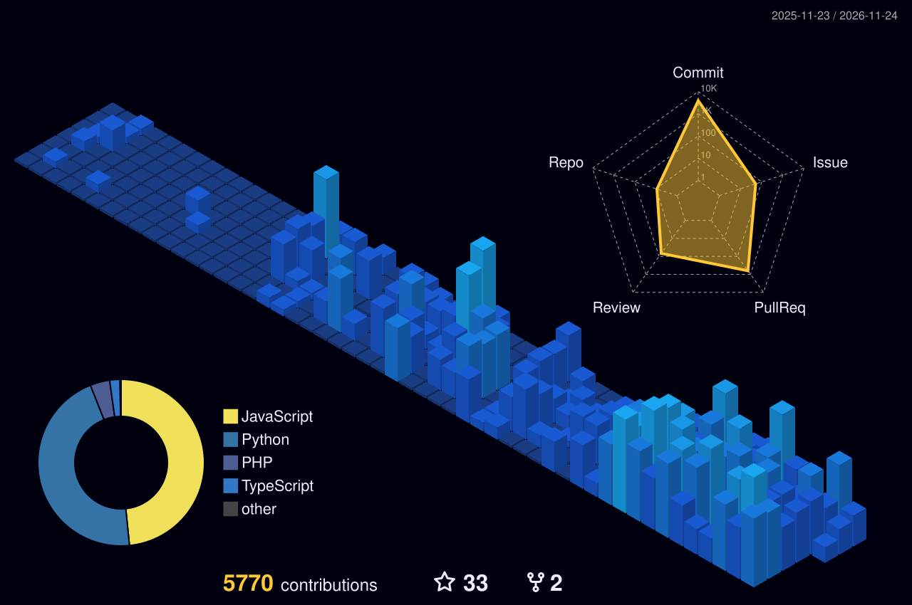

<!-- anime-favorites start -->

<table>
<tr><td align="center"></td><td><h3>👑 JoJo Part 7: Steel Ball Run</h3>📖 Manga · ⭐ 92%  <i>A horse race across America that turns into the best JoJo part. No debate.</i></td></tr>
</table>
 
<h3>🏆 Top 5</h3>
<table>
<tr><td align="center" width="20%"> 🥇 <b>JoJo&#x27;s Bizarre Adventure</b> 📺 Anime · ⭐ 77%</td><td align="center" width="20%"> 🥈 <b>Fullmetal Alchemist: Brotherhood</b> 📺 Anime · ⭐ 90%</td><td align="center" width="20%"> 🥉 <b>Goodnight Punpun</b> 📖 Manga · ⭐ 88%</td><td align="center" width="20%"> #4 <b>Attack on Titan</b> 📺 Anime · ⭐ 85%</td><td align="center" width="20%"> #5 <b>Uzumaki</b> 📖 Manga · ⭐ 79%</td></tr>
</table>

<!-- anime-favorites end -->

Every panel on this page is an SVG generated in this repo by <a href="https://github.com/CodeByHaamza/CodeByHaamza/tree/main/tools"><code>tools/gen_readme.py</code></a> and refreshed every night by GitHub Actions. Fonts: M PLUS Rounded 1c, Dela Gothic One, Anton (SIL Open Font License). Logos: Simple Icons (CC0). Steel ball artwork from <i>Steel Ball Run</i> © Hirohiko Araki / Shueisha, used as a fan homage.
