



[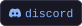](https://discord.gg/personadle)
[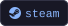](https://steamcommunity.com/id/codebyhaamza)





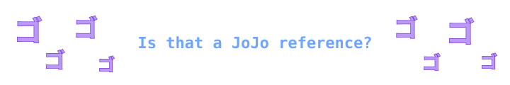

<!-- anime-favorites start -->

<table>
<tr><td align="center"></td><td><h3>👑 JoJo Part 7: Steel Ball Run</h3>📖 Manga · ⭐ 92%  <i>A horse race across America that turns into the best JoJo part. No debate.</i></td></tr>
</table>
 
<h3>🏆 Top 5</h3>
<table>
<tr><td align="center" width="20%"> 🥇 <b>JoJo&#x27;s Bizarre Adventure</b> 📺 Anime · ⭐ 77%</td><td align="center" width="20%"> 🥈 <b>Fullmetal Alchemist: Brotherhood</b> 📺 Anime · ⭐ 90%</td><td align="center" width="20%"> 🥉 <b>Goodnight Punpun</b> 📖 Manga · ⭐ 88%</td><td align="center" width="20%"> #4 <b>Attack on Titan</b> 📺 Anime · ⭐ 85%</td><td align="center" width="20%"> #5 <b>Uzumaki</b> 📖 Manga · ⭐ 79%</td></tr>
</table>

<!-- anime-favorites end -->



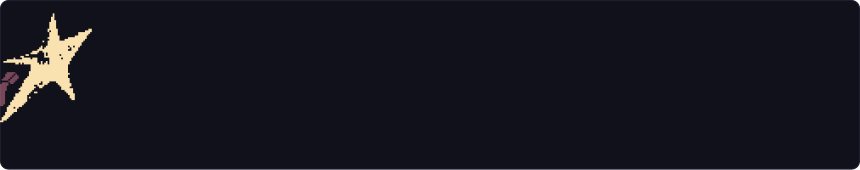

  

Every generated image on this page comes from
[`tools/gen_readme.py`](tools/gen_readme.py) and
[`data/profile.json`](data/profile.json), refreshed daily by a GitHub Action —
no third-party badge service, no external font. The hand-made SVGs in
[`assets/`](assets/) are mine too.

