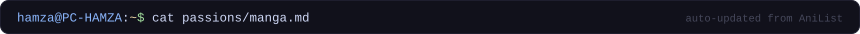

<div align="center">


[](https://personadle.net)
[](https://discord.gg/personadle)
[](https://steamcommunity.com/id/codebyhaamza)
[](mailto:hamza.karrouchi.dev@gmail.com)

</div>


<div align="center"><sub>[Grimoire du Cœur](https://github.com/Grimoire-du-Coeur) · [Persona_GRUB_Themes](https://github.com/CodeByHaamza/Persona_GRUB_Themes) · [personadle](https://github.com/CodeByHaamza/personadle) · [kagami](https://github.com/CodeByHaamza/kagami) · [jojo-arena](https://github.com/CodeByHaamza/jojo-arena) · [p2is-relecture](https://github.com/CodeByHaamza/p2is-relecture) · [ViscoCrowd](https://github.com/ViscoCrowd/ViscoCrowd-simulation) · [five_nights_at_fabron](https://github.com/damien-ledain/five_nights_at_fabron)</sub></div>


<div align="center">

<a href="https://store.steampowered.com/app/1687950/"></a>
<a href="https://store.steampowered.com/app/2161700/"></a>
<a href="https://store.steampowered.com/app/1113000/"></a>
<a href="https://store.steampowered.com/app/1245620/"></a>
<a href="https://store.steampowered.com/app/2358720/"></a>
<a href="https://store.steampowered.com/app/1091500/"></a>

</div>



<!-- anime-favorites start -->
<div align="center">
<table>
<tr><td align="center"><a href="https://anilist.co/manga/31706"></a></td><td><h3>👑 JoJo Part 7: Steel Ball Run</h3><sub>📖 Manga · ⭐ 92%</sub><br/><br/><i>A horse race across America that turns into the best JoJo part. No debate.</i></td></tr>
</table>
<br/>
<h3>🏆 Top 5</h3>
<table>
<tr><td align="center" width="20%"><a href="https://anilist.co/anime/14719"></a><br/><sub>🥇 <b>JoJo&#x27;s Bizarre Adventure</b><br/>📺 Anime · ⭐ 77%</sub></td><td align="center" width="20%"><a href="https://anilist.co/anime/5114"></a><br/><sub>🥈 <b>Fullmetal Alchemist: Brotherhood</b><br/>📺 Anime · ⭐ 90%</sub></td><td align="center" width="20%"><a href="https://anilist.co/manga/34632"></a><br/><sub>🥉 <b>Goodnight Punpun</b><br/>📖 Manga · ⭐ 88%</sub></td><td align="center" width="20%"><a href="https://anilist.co/anime/16498"></a><br/><sub>#4 <b>Attack on Titan</b><br/>📺 Anime · ⭐ 85%</sub></td><td align="center" width="20%"><a href="https://anilist.co/manga/30436"></a><br/><sub>#5 <b>Uzumaki</b><br/>📖 Manga · ⭐ 79%</sub></td></tr>
</table>
</div>
<!-- anime-favorites end -->


<details>
<summary><sub>Plain-text version — every block above is a generated SVG, so here is the same content as selectable text</sub></summary>

```
hamza@PC-HAMZA
  os        Windows 11 Home · build 26300
  cpu       AMD Ryzen 9 9950X3D  (16c / 32t)
  gpu       NVIDIA RTX 5080 · 16 GB GDDR7
  ram       32 GB G.Skill DDR5-6000 CL36
  board     Gigabyte B850 AORUS ELITE WIFI7
  disk      2× Samsung 990 EVO Plus 2 TB · IronWolf 8 TB
  shell     pwsh 7 + oh-my-posh
  display   2× 27" 1440p
  built     5 years of saving up, not of assembling
hamza@karrouchi-server
  os        Ubuntu 26.04 · bash
  runs      backups · PersonaDLE Discord bot
            game servers · scrapers
  stack     docker compose, all of it

stack
languages      typescript · python · php · javascript · java · c · bash
web            react · three.js · vite · node · nestjs · pwa
data           mariadb · mysql · mongodb · pandas · numpy
infra          docker · compose · github actions · apache · cloudflare · ubuntu
quality        vitest · playwright · pytest · ruff · eslint · prettier
rabbit holes   mediapipe · onnxruntime-web · pygame-ce · psp eboot
gym            full body 3×/week, tracked in a repo like everything else

projects
Grimoire du Cœur       French Persona / SMT / Atlus community — I run it    https://github.com/Grimoire-du-Coeur
Persona_GRUB_Themes    70+ bootloader themes for Persona fans               https://github.com/CodeByHaamza/Persona_GRUB_Themes
personadle             daily Persona guessing game, 6 modes                 https://github.com/CodeByHaamza/personadle
kagami                 anime hand-signs recognised by your webcam           https://github.com/CodeByHaamza/kagami
jojo-arena             1v1 top-down pixel arena fighter                     https://github.com/CodeByHaamza/jojo-arena
p2is-relecture         proofreading webapp for the Persona 2 translation    https://github.com/CodeByHaamza/p2is-relecture
ViscoCrowd             particle simulation of a panicking pool evacuation   https://github.com/ViscoCrowd/ViscoCrowd-simulation
five_nights_at_fabron  point-and-click horror survival game                 https://github.com/damien-ledain/five_nights_at_fabron

private        suivi-muscu · P1-FR · P5RS mod · personadle-discord
```

</details>

<div align="center"><sub>

Every image on this page is generated by
[`tools/gen_readme.py`](tools/gen_readme.py) from
[`data/profile.json`](data/profile.json) and refreshed by a GitHub Action.
No third-party badge service, no external font, no external image — except the
Steam and AniList covers above.

</sub></div>
