<!-- Généré par tools/gen_readme.py : modifier data/profile.json ou le générateur, pas ce fichier. -->

    

<h3 align="center">Favourite games</h3>

<picture><source media="(prefers-color-scheme: dark)" srcset="assets/gen/stats-dark.svg"></picture>

<h3 align="center">Stand Arrow</h3>

<!-- stand-arrow start -->

<b>2</b> arrows shot · <b>2</b> Stand users · <b>2/165</b> Stands awakened · one arrow per visitor per day

| Stand user | Stand | Part | Date |
|:--|:--|:-:|:--|
| [@lennymgrd](https://github.com/lennymgrd) | Kiss | 6 | 2026-11-17 |
| [@shalee-pnt](https://github.com/shalee-pnt) | November Rain | 9 | 2026-11-17 |
<!-- stand-arrow end -->

<!-- anime-favorites start -->

<table>
<tr><td align="center"></td><td><h3>👑 JoJo Part 7: Steel Ball Run</h3>📖 Manga · ⭐ 92%  <i>A horse race across America that turns into the best JoJo part. No debate.</i></td></tr>
</table>
 
<h3>🏆 Top 5</h3>
<table>
<tr><td align="center" width="20%"> 🥇 <b>JoJo&#x27;s Bizarre Adventure</b> 📺 Anime · ⭐ 77%</td><td align="center" width="20%"> 🥈 <b>Fullmetal Alchemist: Brotherhood</b> 📺 Anime · ⭐ 90%</td><td align="center" width="20%"> 🥉 <b>Goodnight Punpun</b> 📖 Manga · ⭐ 88%</td><td align="center" width="20%"> #4 <b>Attack on Titan</b> 📺 Anime · ⭐ 85%</td><td align="center" width="20%"> #5 <b>Uzumaki</b> 📖 Manga · ⭐ 79%</td></tr>
</table>

<!-- anime-favorites end -->

<picture><source media="(prefers-color-scheme: dark)" srcset="https://raw.githubusercontent.com/CodeByHaamza/CodeByHaamza/output/snake-dark.svg"></picture>

Every panel on this page is an SVG generated in this repo by <a href="https://github.com/CodeByHaamza/CodeByHaamza/tree/main/tools"><code>tools/gen_readme.py</code></a> and refreshed every night by GitHub Actions. Fonts: M PLUS Rounded 1c, Dela Gothic One, Anton (SIL Open Font License). Logos: Simple Icons (CC0). Stand images from <a href="https://jojowiki.com">JoJo's Bizarre Encyclopedia</a>. <i>JoJo's Bizarre Adventure</i> and its artwork © Hirohiko Araki / Shueisha, used as a fan homage.
