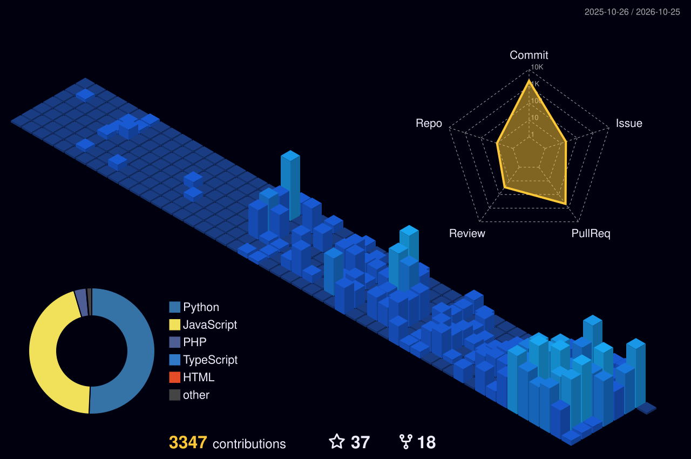
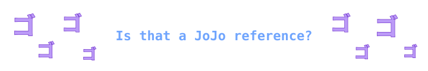

## 💫 About Me

- 🎓 Third-year Computer Science student (BUT Informatique) in a work-study program, aiming for an engineering degree or a master's next
- 🔭 Currently working on **[PersonaDLE](https://personadle.net)**, a daily guessing game based on the Persona series (Vanilla JS, PHP, MariaDB, Docker)
- 🌍 Translating Persona 1 (PSP) into French, digging into reverse-engineering and tooling along the way
- ⚛️ Learned React during my internship and now use it in my personal projects
- 🌱 Currently learning Kubernetes and exploring new tools across the stack
- 👯 Open to collaborating on fan translation projects, game-related web apps and dev tools
- 💬 Ask me about the Persona / Shin Megami Tensei series, ROM hacking or Docker setups
- 🎮 Passionate about video games, manga & anime, tech and sports
- 🏋️ Back at the gym, and planning to build a website to track my progress
- ⚡ Fun fact: my PC took 5+ years to build: not because of the assembly, but because of the saving and the endless component research

<b>🔥 My Rig & Setup (The 5-Year Build)</b>

 

*Good things come to those who wait.*

- **CPU:** AMD Ryzen 9 9950X3D
- **GPU:** NVIDIA RTX 5080
- **Homelab:** Dockerized ecosystem running custom apps, web scraping tools and game servers

## 💻 Tech Stack

**Languages**

**Frontend**

**Backend & Databases**

**DevOps & Tools**

**And also**

      

## 📊 GitHub Analytics

  
  

 

  

 

  

 

  <picture>
    <source media="(prefers-color-scheme: dark)" srcset="https://raw.githubusercontent.com/CodeByHaamza/CodeByHaamza/output/snake-dark.svg"/>
    <source media="(prefers-color-scheme: light)" srcset="https://raw.githubusercontent.com/CodeByHaamza/CodeByHaamza/output/snake-light.svg"/>
    
  </picture>

 

## 🎮 Gaming Corner

  

<!-- steam-games start -->

<table>
<tr><td align="center" width="33%"> <b>Cyberpunk 2077</b> ⏱️ 25h played</td><td align="center" width="33%"> <b>Noita</b> ⏱️ 5h played</td><td align="center" width="33%"> <b>Lethal Company</b> ⏱️ 10h played</td></tr>
<tr><td align="center" width="33%"> <b>Persona 4 Arena Ultimax</b> ⏱️ 7h played</td><td align="center" width="33%"> <b>Your Only Move Is HUSTLE</b> ⏱️ 8h played</td><td align="center" width="33%"> <b>People Playground</b> ⏱️ 53h played</td></tr>
</table>

<!-- steam-games end -->

<b>⭐ All-Time Favorites</b>

 

<table>
<tr>
<td align="center" width="25%"> <b>Persona 5 Royal</b></td>
<td align="center" width="25%"> <b>Persona 3 Reload</b></td>
<td align="center" width="25%"> <b>Persona 4 Golden</b></td>
<td align="center" width="25%"> <b>Elden Ring</b></td>
</tr>
<tr>
<td align="center" width="25%"> <b>Black Myth: Wukong</b></td>
<td align="center" width="25%"> <b>Cyberpunk 2077</b></td>
<td align="center" width="25%"> <b>Red Dead Redemption 2</b></td>
<td align="center" width="25%"> <b>Dark Souls III</b></td>
</tr>
</table>

## 🍥 Manga & Anime Corner

  

<!-- anime-favorites start -->

<table>
<tr><td align="center"></td><td><h3>👑 JoJo Part 7: Steel Ball Run</h3>📖 Manga · ⭐ 92%  <i>A horse race across America that turns into the best JoJo part. No debate.</i></td></tr>
</table>
 
<h3>🏆 Top 5</h3>
<table>
<tr><td align="center" width="20%"> 🥇 <b>JoJo&#x27;s Bizarre Adventure</b> 📺 Anime · ⭐ 77%</td><td align="center" width="20%"> 🥈 <b>Fullmetal Alchemist: Brotherhood</b> 📺 Anime · ⭐ 90%</td><td align="center" width="20%"> 🥉 <b>Goodnight Punpun</b> 📖 Manga · ⭐ 88%</td><td align="center" width="20%"> #4 <b>Attack on Titan</b> 📺 Anime · ⭐ 85%</td><td align="center" width="20%"> #5 <b>Uzumaki</b> 📖 Manga · ⭐ 79%</td></tr>
</table>

<!-- anime-favorites end -->

 

  

