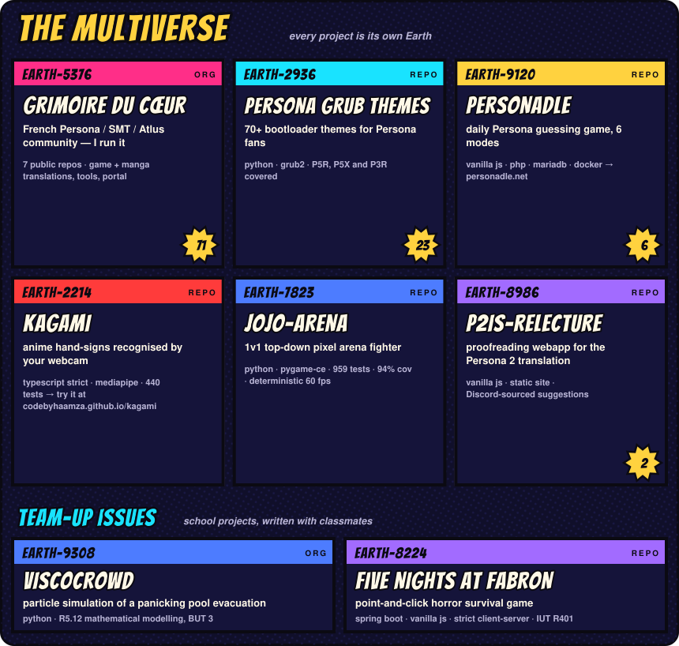
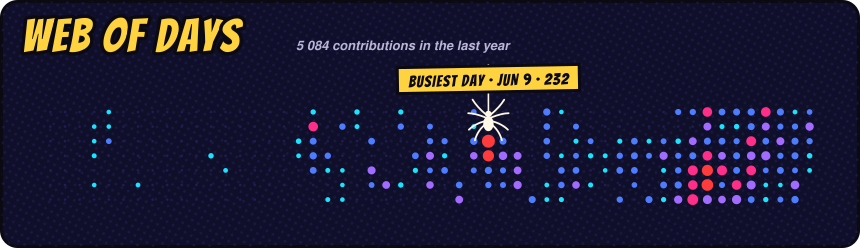

    

**languages** typescript, python, php, javascript, java, c, bash · **web** react, three.js, vite, node, nestjs, pwa · **data** mariadb, mysql, mongodb, pandas, numpy · **infra** docker, compose, github actions, apache, cloudflare, ubuntu · **quality** vitest, playwright, pytest, ruff, eslint, prettier · **rabbit holes** mediapipe, onnxruntime-web, pygame-ce, psp eboot

| Earth | Project | What it does | Built with |
| :-- | :-- | :-- | :-- |
| `EARTH‑5376` | **[Grimoire du Cœur](https://github.com/Grimoire-du-Coeur)** | French Persona / SMT / Atlus community — I run it | 7 public repos · game + manga translations, tools, portal |
| `EARTH‑2936` | **[Persona_GRUB_Themes](https://github.com/CodeByHaamza/Persona_GRUB_Themes)** | 70+ bootloader themes for Persona fans | python · grub2 · P5R, P5X and P3R covered |
| `EARTH‑9120` | **[personadle](https://github.com/CodeByHaamza/personadle)** | daily Persona guessing game, 6 modes | vanilla js · php · mariadb · docker  →  personadle.net |
| `EARTH‑2214` | **[kagami](https://github.com/CodeByHaamza/kagami)** | anime hand-signs recognised by your webcam | typescript strict · mediapipe · 440 tests  →  try it at codebyhaamza.github.io/kagami |
| `EARTH‑7823` | **[jojo-arena](https://github.com/CodeByHaamza/jojo-arena)** | 1v1 top-down pixel arena fighter | python · pygame-ce · 959 tests · 94% cov · deterministic 60 fps |
| `EARTH‑8986` | **[p2is-relecture](https://github.com/CodeByHaamza/p2is-relecture)** | proofreading webapp for the Persona 2 translation | vanilla js · static site · Discord-sourced suggestions |
| `EARTH‑9308` | **[ViscoCrowd](https://github.com/ViscoCrowd/ViscoCrowd-simulation)** | particle simulation of a panicking pool evacuation | python · R5.12 mathematical modelling, BUT 3 |
| `EARTH‑8224` | **[five_nights_at_fabron](https://github.com/damien-ledain/five_nights_at_fabron)** | point-and-click horror survival game | spring boot · vanilla js · strict client-server · IUT R401 |

Also in the lab, private for now: suivi-muscu · P1-FR · P5RS mod · personadle-discord.

     

<!-- anime-favorites start -->

<table>
<tr><td align="center"></td><td><h3>👑 JoJo Part 7: Steel Ball Run</h3>📖 Manga · ⭐ 92%  <i>A horse race across America that turns into the best JoJo part. No debate.</i></td></tr>
</table>
 
<h3>🏆 Top 5</h3>
<table>
<tr><td align="center" width="20%"> 🥇 <b>JoJo&#x27;s Bizarre Adventure</b> 📺 Anime · ⭐ 77%</td><td align="center" width="20%"> 🥈 <b>Fullmetal Alchemist: Brotherhood</b> 📺 Anime · ⭐ 90%</td><td align="center" width="20%"> 🥉 <b>Goodnight Punpun</b> 📖 Manga · ⭐ 88%</td><td align="center" width="20%"> #4 <b>Attack on Titan</b> 📺 Anime · ⭐ 85%</td><td align="center" width="20%"> #5 <b>Uzumaki</b> 📖 Manga · ⭐ 79%</td></tr>
</table>

<!-- anime-favorites end -->

  

Every panel on this page is an SVG generated in this repo by <a href="tools/gen_readme.py"><code>tools/gen_readme.py</code></a> and refreshed every night by GitHub Actions — no external service. Comic lettering: Bangers (SIL Open Font License). Logos: Simple Icons (CC0). Spider-Man belongs to Marvel and Sony; this page is a fan-made homage.
